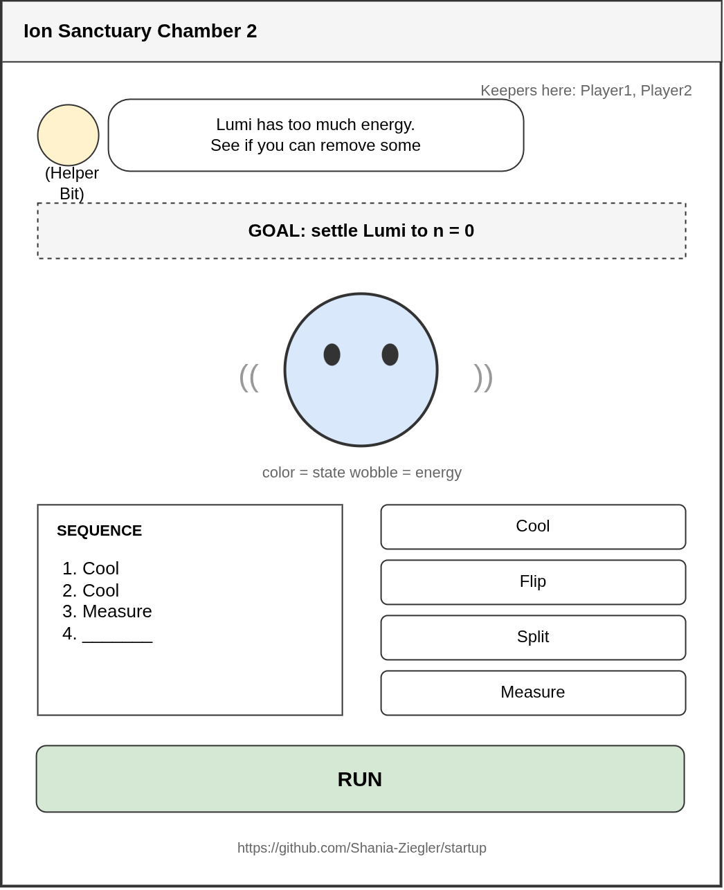
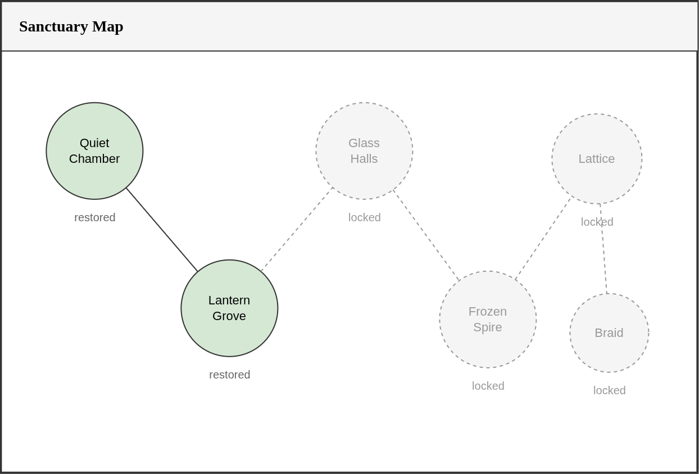
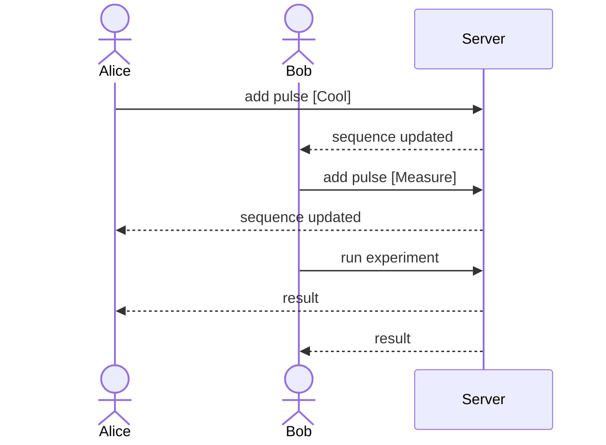

# Quantum Sanctuary 

[My Notes](notes.md)

### Elevator pitch
The hardware behind quantum computers can have a reputation for being challenging to understand, and most explanations open with equations that seem complex. Quantum Sanctuary takes a lighter approach: it gives you quantum particles to look after. You are an apprentice restoring a sanctuary of quantum spirits, each chamber home to a different one, and Lumi, a trapped ion, lives in the first. You cannot touch her or move her yourself; the only way to reach her is with light. Each chamber gives you a goal and a few kinds of pulses, and you put them in order, run the experiment, and read the result off Lumi herself. Her color shows her state and her wobble shows her energy. Two apprentices can share a chamber and run experiments together in real time. By the end you will understand some basic terminology, and you will have picked it up playing with friends. 

### Design

The chamber view at first chamber. 
Bit gives the goal at the top, Lumi sits in the middle
The pulses you can use along with the sequence you are building are below her.

The sanctuary map. Each chamber holds a different kind of quantum spirit, and they unlock as you restore the ones before them.

This sequence diagram shows two players sharing a chamber.

### Key features
- Secure login over HTTPS
- Ability to select a chamber from the sanctuary map
- Ability to add and remove pulses to build a sequence
- Ability to run the sequence and watch Lumi react
- Sequence changes from other apprentices displayed in realtime
- Progress and best scores are persistently stored

### Technologies

I am going to use the required technologies in the following ways.

- **HTML** - Uses HTML structure for the application. Four views: entrance, login, sanctuary map, and chamber. Hyperlink to my GitHub repository on the home page.
- **CSS** - Application styling that works across screen sizes. Lumi is animated with CSS keyframes so she floats and wobbles according to her current state.
- **React** - Single page application. Components for the pulse buttons, the sequence, Lumi, and the chamber view. React routing moves between the entrance, login, map, and chamber views based on what the user does.
- **Service** - Backend service with endpoints for:
  - register, login, and logout
  - retrieving a chamber's goal and available pulses
  - submitting a sequence and returning the result and score
  - saving and retrieving player progress
  - retrieving measurement randomness from [qrandom.io](https://qrandom.io/docs), falling back to a local random number generator if the service is rate limited or down
- **DB/Login** - Store users, progress, and best scores in MongoDB. Register and login users. Credentials securely stored in the database. Cannot play unless authenticated.
- **WebSocket** - The sequence is shared between players in a chamber. As each one adds or removes a pulse, the change is broadcast to the others, and running the experiment is broadcasted to the other players.

## 🚀 Specification Deliverable

> [!NOTE]
> Fill in this sections as the submission artifact for this deliverable. You can refer to this [example](https://github.com/webprogramming260/startup-example/blob/main/README.md) for inspiration.

For this deliverable I did the following. I checked the box `[x]` and added a description for things I completed.

- [x] I completed the prerequisites for this deliverable (Git commit requirement)
- [x] Proper use of Markdown
- [x] A concise and compelling elevator pitch
- [x] Description of key features
- [x] Description of how you will use each technology including your 3rd party API and use of WebSocket
- [x] One or more rough sketches of your application. Images must be embedded in this file using Markdown image references.

## 🚀 AWS deliverable

For this deliverable I did the following. I checked the box `[x]` and added a description for things I completed.

- [x] **Rented EC2 server** 
- [x] **Leased domain name** 
- [x] **Server accessible** from my domain: [https://quantumsanctuary.click](https://quantumsanctuary.click) - Working over HTTPS with a certificate issued by Caddy.

## 🚀 HTML deliverable

For this deliverable I did the following. I checked the box `[x]` and added a description for things I completed.

- [x] I completed the prerequisites for this deliverable (Simon deployed, GitHub link, Git commits)
- [x] **HTML pages** - Five different pages. One for each view. `index.html` (login), `map.html` (the sanctuary), `chamber.html` (the puzzle), `journal.html`, and `about.html`.
- [x] **Proper HTML element usage** - I used header, nav, ul, main, section, aside, footer, form, label, input, button, table, meter, img, and many more.
- [x] **Links** - Links between views.
- [x] **Text** - The about page explains what the game is and lists the five kinds of quantum hardware. The journal page has entries describing the quantum ideas the player have unlocked.
- [x] **3rd party API placeholder** - The chamber page has a place under the Run button where measurement outcomes will be drawn from qrandom.io.
- [x] **Images** - The sanctuary map image is displayed on the map page.
- [x] **Login placeholder** - Placeholder for auth on the login page, with username, password, and remember me. The player name is displayed in the header of every page.
- [x] **DB data placeholder** - Progress and a best scores table displayed on the map page as placeholder.
- [x] **WebSocket placeholder** - The chamber page has an aside listing which players are in the chamber and what pulses they added.

## 🚀 CSS deliverable

For this deliverable I did the following. I checked the box `[x]` and added a description for things I completed.

- [x] I completed the prerequisites for this deliverable (Simon deployed, GitHub link, Git commits)
- [x] **Visually appealing colors and layout. No overflowing elements.** 
- [x] **Use of a CSS framework** - Bootstrap 5.3 is imported at the top of `main.css` and used for accessibility utilities, including screen-reader-only text (`visually-hidden`) and the keyboard-focusable "Skip to main content" link (`visually-hidden-focusable`) on every page. The application's visual design is implemented with custom CSS.
- [x] **All visual elements styled using CSS** 
- [x] **Responsive to window resizing using flexbox and/or grid display**
- [x] **Use of a imported font** 
- [x] **Use of different types of selectors including element, class, ID, and pseudo selectors**

## 🚀 React part 1: Routing deliverable

For this deliverable I did the following. I checked the box `[x]` and added a description for things I completed.

- [x] I completed the prerequisites for this deliverable (Simon deployed, GitHub link, Git commits)
- [x] **Bundled using Vite** - Installed Vite with the React plugin and restructured the project the way Vite expects: `index.html` at the root as a single page shell containing only `
`, and all source under `src/`. Added `vite.config.js`, and the sketch images moved to `public/`. Deployed with `deployReact.sh`, which runs `npm run build` and ships the bundled `dist` folder.
- [x] **Components** - Converted all six HTML pages into React components: `Login`, `Register`, `Sanctuary` (the map), `Chamber`, `Journal`, and `About`, each in its own folder under `src/`. The shared header, navigation, and footer live once in `app.jsx` instead of being repeated on every page. My stylesheet moved to `src/app.css` and is imported in `main.jsx` along with Bootstrap.
- [x] **Router** - `main.jsx` wraps the app in `BrowserRouter`. `app.jsx` defines the routes: `/` for login, `/register`, `/map`, `/chamber`, `/journal`, `/about`, and a catch-all for unknown paths. Navigation uses `NavLink`, which marks the current view with `aria-current="page"`, so moving between views no longer reloads the page.

## 🚀 React part 2: Reactivity deliverable

For this deliverable I did the following. I checked the box `[x]` and added a description for things I completed.

- [x] I completed the prerequisites for this deliverable (Simon deployed, GitHub link, Git commits)
- [x] **All functionality implemented or mocked out** - All five chambers are playable end to end with no backend (I may change the game mechanics slightly while keeping the react ect all functional). Login, chamber routing, building and editing a sequence, running an experiment, completing levels, and unlocking the next chamber all work. Progress persists in localStorage, which stands in for the database. Login accepts any credentials, and the multiplayer feed is a mocked notifier until the WebSocket deliverable.
- [x] **Hooks** - `useState` for sequences, table layout, run state, counts, hints, and results. `useEffect` for mount tracking, the activity feed, and level resets. `useRef` for re-entrancy guards and run tickets. `useMemo` for beam intensity on the optical table. A custom `useLookAtPointer` hook, plus login state in `App`.

## 🚀 Service deliverable

For this deliverable I did the following. I checked the box `[x]` and added a description for things I completed.

## 🚀 Service deliverable

For this deliverable I did the following. I checked the box `[x]` and added a description for things I completed.

- [x] I completed the prerequisites for this deliverable (Simon deployed, GitHub link, Git commits)
- [x] **Node.js/Express HTTP service** Created `service/index.js` as a separate backend application with its own `package.json`, listening on port 4000. Uses `express.json()` and `cookie-parser` middleware, an `express.Router()` mounted at `/api`, an error handler, and a default handler that returns `index.html` so React routing works on refresh.
- [x] **Static middleware for frontend** `app.use(express.static('public'))` serves the bundled React frontend from the service's `public` directory in production.
- [x] **Calls to third party endpoints** `src/chamber/quantumRandom.js` fetches random numbers from qrandom.io, with ANU's quantum RNG and csrng.net as backups and `Math.random` as a final fallback. The glass hall section uses these values to decide which detector each photon lands in, so measurement outcomes come from randomness rather than a pseudo-random sequence. The optical bench displays which source is in use.
- [x] **Backend service endpoints** `GET/PUT/DELETE /api/progress` for a player's chamber progress, `GET/POST /api/activity` for the player feed, and `GET /api/leaderboard` for top players. The PUT merges rather than overwrites so a stale client cannot roll back progress, and all incoming data is validated server side.
- [x] **Frontend calls service endpoints** `src/progress.js` loads progress on sign in and saves it on a debounced PUT whenever a level is solved or a control discovered, falling back to localStorage when offline. `src/user.jsx` calls the auth endpoints and restores the session on page load.
- [x] **Supports registration, login, logout, and restricted endpoint** `POST /api/auth/create`, `POST /api/auth/login`, `DELETE /api/auth/logout`, and `GET /api/auth/me`. Auth tokens are UUIDs stored in an HTTP cookie set with `httpOnly`, `secure`, and `sameSite: strict`. A `verifyAuth` middleware guards every endpoint except create and login, returning 401 without a valid token.
- [x] **Uses BCrypt to hash passwords** Passwords are hashed with `bcrypt.hash(password, 10)` on registration and theyre checked with `bcrypt.compare`. The plaintext password is never stored/logged.

## 🚀 DB deliverable

For this deliverable I did the following. I checked the box `[x]` and added a description for things I completed.

- [ ] I completed the prerequisites for this deliverable (Simon deployed, GitHub link, Git commits)
- [ ] **Stores data in MongoDB** - I did not complete this part of the deliverable.
- [ ] **Stores credentials in MongoDB** - I did not complete this part of the deliverable.

## 🚀 WebSocket deliverable

For this deliverable I did the following. I checked the box `[x]` and added a description for things I completed.

- [ ] I completed the prerequisites for this deliverable (Simon deployed, GitHub link, Git commits)
- [ ] **Backend listens for WebSocket connection** - I did not complete this part of the deliverable.
- [ ] **Frontend makes WebSocket connection** - I did not complete this part of the deliverable.
- [ ] **Data sent over WebSocket connection** - I did not complete this part of the deliverable.
- [ ] **WebSocket data displayed** - I did not complete this part of the deliverable.
- [ ] **Application is fully functional** - I did not complete this part of the deliverable.
